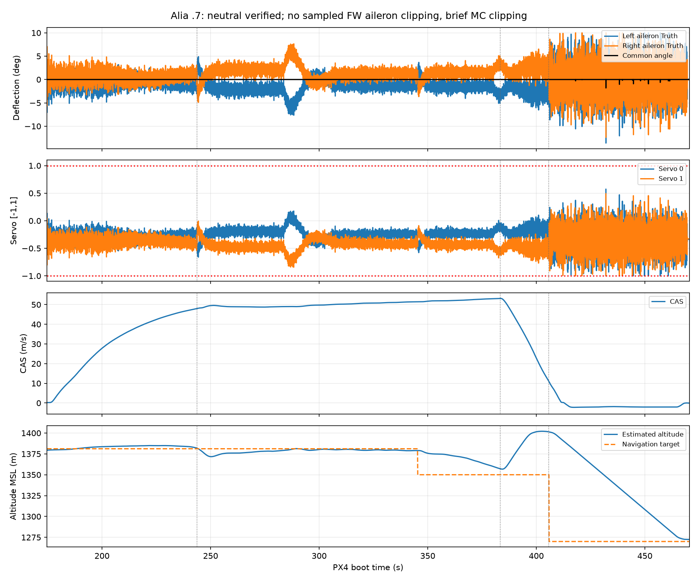

# Alia 250 Accepted Simulator Profile

The operator accepted the November 8, 2026 flight for its observed handling.
This freezes that configuration, not a full operating envelope, power-reserve
claim or real-aircraft tune. No new plugin binary or controller patch is required.

## Default And Experimental Pairings

| Use | PX4 parameters |
| --- | --- |
| Normal official setup | Defaults in the selected official PX4 checkout |
| Packaged reference | `config/px4_params/5020_xplane_alia250`, synchronized to official `95a0c2348232` |
| Accepted experimental tune | `config/experimental/alia250/5020_xplane_alia250`, the same source plus the eight changes below |

All use built-in Alia, plugin section `Alia250`, target `xplane_alia250` and
`SYS_AUTOSTART=5020`. Retain channel directions/endpoints and disabled lift-prop
auto-brakes. No model replacement or engine-power increase is needed.
Plugin references are not loaded by PX4. Neither plain `px4xplane` nor
`--validation` applies this experimental file. Owner capture/upload services
are not required by the public launcher.

## Frozen Changes

| Parameter | Official baseline | Accepted trial | Purpose |
| --- | ---: | ---: | --- |
| WV_YRATE_MAX | 90 | 10 | Lower automatic weathervane yaw-rate demand |
| FW_P_TC | 0.4 | 1.0 | Slower outer-loop pitch response |
| VT_B_DEC_I | 0.25 | 0.08 | Reduce braking-pitch integral response |
| VT_B_TRANS_DUR | 28 | 40 | More time available for back-transition |
| VT_ARSP_TRANS | 40 | 48 | Later wing-borne handoff |
| FW_RR_FF | 0.5 | 1.5 | Roll-rate feedforward |
| CA_SV_CS0_TRIM | 0 | -0.3333333333 | Left aileron neutral calibration |
| CA_SV_CS1_TRIM | 0 | -0.3333333333 | Right aileron neutral calibration |

Scenario altitude and logging settings are excluded. Estimator, MC gains,
TECS, NPFG, mass parameters and all other defaults remain unchanged from the pin.

Pinned metadata maxima are 30 m/s for VT_ARSP_TRANS and 20 s for VT_B_TRANS_DUR;
this trial exceeds both. Stock Alia already exceeds them. Public-default promotion
requires explicit upstream review: do not silently clamp the flown values or
widen global limits. Keep this profile separate until that review.

## Neutral And Control Margin

The existing aileron range [-20, +10] degrees maps zero HIL input to -5 degrees.
With PWM_MAIN_REV=112 and servo functions 201/202 on outputs 5/6, two -1/3 trims
produce +1/3 HIL input and geometric zero common deflection. Elevator/rudder trims
remain zero. See [PX4's trimming guide](https://docs.px4.io/main/en/config_fw/trimming_guide_fixedwing).

Local mapping slope and hard endpoints stay unchanged, but equal/opposite
increments first clip at magnitude 2/3 instead of 1. Check active outputs and
physical angles, not disarmed zeros. Output-center settings can reset allocator
trims, so verify retention after startup and during flight.

## Evidence And Limits

The retained run used official PX4 `95a0c23482329183d932ac99da00faa7e8d63143`
and these eight overrides at recorded mass 2857.22 kg. On-disk aircraft/config/
plugin identities stayed unchanged. ZIP integrity/all 28 file checks passed;
the 144,097,996-byte ULog has no dropouts or in-flight parameter edits. Loaded
model memory was not independently hashed.

- Aileron common deflection is effectively zero through front/FW/back flight;
  retained trims and simulated outputs confirm the intended neutral.
- No sampled FW aileron clipping; maximum absolute FW servo command 0.843.
  Brief virtual-FW surface clipping remains in MC descent (under 0.4% of sampled
  commands in that phase); it did not prevent this landing.
- Last 30 s of Hold: bank error 0.293 degrees RMS, body roll-rate error
  0.624 degrees/s RMS and radial error 4.57 m RMS. Capture is excluded from these
  settled figures; this was not a full lap.
- Front transition took 69.05 s; back-transition 22.40 s. Back-transition gained
  about 45 m: smooth completion alone does not establish passenger comfort.
- Landing/automatic disarm completed. Filter fault flags stayed zero; peak
  absolute accelerometer-bias component was 0.0472 m/s2.

The requested 120 s straight-level segment was not flown. QGC commanded takeoff
near 110 m, not the runner's 200 m default. Late circle flight still used full
pusher throttle at about CAS51 m/s. Terminal speed, cruise reserve, stall,
payload/CG, wind and low-FPS envelopes remain unproven. Neutral calibration is
verified; drag reduction or optimal aerodynamic trim is not. Do not add another
gain change without an identified residual and controlled comparison.

Native Lua overrides the displayed propeller angle: that rendering channel
does not prove physical rotor parking. These data establish no new PX4 core bug
or justification for a brake/power patch.

## Continuing Development

Use a dedicated PX4 development branch based on the recorded source. Review the
experimental file against its Alia defaults before replacing that branch's
airframe file; build the normal target. Keep saved parameters isolated. The
guided launcher can select an intentionally prepared source using `--px4-repo`,
`--px4-branch` and `--px4-path`; an explicit selected-runtime reset loads reviewed
defaults. This is not an automatic private patch or service dependency.

Follow the [Alia test card](ALIA_XPLANE12_TEST.md). Wider-envelope work is a
future phase. PX4 draft #29598 stays compact-QuadTailsitter scoped and is not
changed or validated by this Alia flight.
